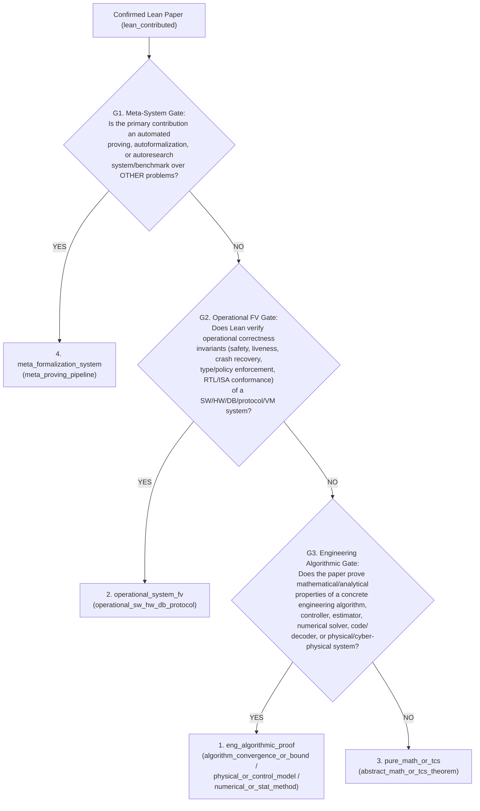

# Track 1: 4-Way Domain-Role Coding Rubric & 1-Page Decision Tree

**Version:** 1.0 (Phase A1 Draft — Ready for Phase B2 Dual-Rater Validation & Phase C1 Stage-4 Prompt Upgrade)  
**Scope:** Confirmed Lean-contributing papers (`lean_usage_status == "lean_contributed"`)  
**Goal:** Replace the ambiguous 3-way `paper_domain_role` label (v0.6 blinded Stage-4 conditional $\kappa = 0.217$, $\alpha = 0.160$) with an auditable **sequential 4-gate decision tree** (`role_4way`) paired with an orthogonal secondary tag (`verification_object`), targeting conditional Human–Human and Human–LLM $\kappa \ge 0.75$.

---

## 1. Quick-Reference 4-Gate Decision Tree (Evaluate Strictly in Order G1 → G4)

Evaluate each paper by **its primary research contribution and verification target** (title, abstract, introduction, and theorem inventory — *not* by arXiv primary category alone and *not* by whether a partial Lean supplement only finished elementary helper lemmas). Stop at the **first gate** that answers **YES**.



---

## 2. Primary Buckets & Orthogonal Secondary Tag (`verification_object`)

| Gate | `role_4way` (Primary Bucket) | Allowed `verification_object` | Operational Inclusion Test | Canonical In-Corpus Anchors |
| :---: | :--- | :--- | :--- | :--- |
| **G1** | `meta_formalization_system` | `meta_proving_pipeline` | Primary contribution is an **automated system, agentic loop, or benchmark** that discovers, translates, or verifies Lean proofs across *multiple external problems/papers*, rather than proving a single original domain theorem of its own. | `2611.26272` (*Paper2Lean*), `2611.13872` (*LongTails*), `2611.23080` (*Colombo*) |
| **G2** | `operational_system_fv` | `operational_sw_hw_db_protocol` | Lean verifies **operational correctness invariants** (safety, liveness, progress, crash/snapshot consistency, type/memory safety, policy enforcement, trust boundaries, RTL/ISA/VM conformance) of a software, database, hardware, concurrent-object, or consensus/security state machine. | `2611.10810` (DBLog CDC), `2611.19551` (TrustBound), `2611.20298` (RPC type-confusion), `2611.25599` (Tether), `2605.16407` (LLM trust certs), `2605.19531` (PODC conflict-freedom), `2511.15517` (Beluga BFT) |
| **G3** | `eng_algorithmic_proof` *(Core Target)* | `algorithm_convergence_or_bound` · `physical_or_control_model` · `numerical_or_stat_method` | Paper's main theorem proves **quantitative or structural mathematical guarantees** (convergence, regret, stability, identifiability, optimality, error/discretization bounds, decoding/capacity/leakage bounds, physical/dynamical bounds) for a **concrete engineering algorithm, controller, estimator, numerical solver, communication/coding/crypto scheme, or physical/cyber-physical system**. | `2611.05243` (AltOMD), `2611.13584` (heavy-ball), `2611.12680` (Wolfe MNP), `2611.10902` (EV charging), `2611.18220` (System ID), `2611.16781` (chain fountain), `2611.11713` (BP decoding), `2611.12585` (KdV Galerkin), `2611.18455` (particle SDE), `2611.22468` ($(s,S)$ inventory) |
| **G4** | `pure_math_or_tcs` | `abstract_math_or_tcs_theorem` | Default fallback when G1–G3 are NO: primary contribution is a theorem in **pure mathematics** (algebraic geometry, spectral/operator theory, number theory, combinatorics), **theoretical CS** (circuit/complexity classes, CONGEST/anonymous-network round complexity, graph approximation, formal logic/synthesis), or **foundational quantum information** — even if cross-listed into `math.OC`, `cs.DC`, `cs.IT`, or `cs.CR`. | `2611.16690` (Hilbert 17th), `2611.09050` (Jacobi matrices), `2611.08172` (AG-code tower), `2611.05136` ($TC^0$ lattices), `2611.15431` (Nichols–Wootters entropies), `2611.04561` (LTL synthesis), `2611.01761` / `02057` / `02256` / `15201` (CONGEST/dynamic networks), `2611.13585` (graphic TSP), `2605.05801` (epistemic logic) |

---

## 3. Explicit Boundary Rules (Resolving All Stage-4 IRR Discrepancies)

Apply these six tie-breaking rules whenever a paper sits near a bucket boundary:

- **Rule B1 — Meta-System Precedence (G1 overrides domain):** If a paper builds an automated proving/discovery system *for optimization* (e.g., `2611.13872` *LongTails*, `2611.23080` *Colombo*, `2611.26272` *Paper2Lean*), code **`meta_formalization_system`**, *not* `eng_algorithmic_proof` or `pure_math_or_tcs`. A tutorial or methodology paper that manually/semi-automatically formalizes specific domain theorems without introducing a general multi-paper proving pipeline (e.g., `2611.18220` *Lean for System Identification*) fails G1 and proceeds to G3 (`eng_algorithmic_proof`).
- **Rule B2 — Paper-Level Target, Not Partial Lean Slice:** Classify by the **paper's headline scientific target**, not by how narrow its partial Lean supplement is. If an estimation/signal-processing paper (`2605.14610` PATP) or nonconvex optimization paper (`2611.01384` nonsmooth phase retrieval) only formalizes supporting algebraic or Appendix C inequalities in Lean, it is still **`eng_algorithmic_proof`** (with `Mode2_ScopeDowngrade` recorded separately in static risk flags — never demote a partial engineering formalization to `pure_math_or_tcs` just because the verified sub-lemmas are algebraic).
- **Rule B3 — Quantitative Security/Leakage/Coding Bounds vs. Operational Protocol/HW FV (G2 vs. G3):**
  - Code **`operational_system_fv`** (G2) when Lean verifies *execution invariants* of a software/hardware/database/protocol state machine: safety, liveness, atomic snapshot consistency (`2611.10810`), admission-fencing completeness (`2611.19551`), type-confusion soundness of a calculus (`2611.20298`), policy-engine enforcement (`2611.25599`), certificate-pipeline trust boundaries (`2605.16407`), or BFT consensus safety (`2511.15517`).
  - Code **`eng_algorithmic_proof`** (G3) when Lean proves *quantitative mathematical bounds* (statistical leakage/preimage cardinality, differential mixing variance, proximity-gap soundness error, simulator work) for a cryptographic algorithm, masking scheme, mixnet, or coding primitive (`2605.02856`, `2611.04876`, `2611.22732`, `2611.15128`).
  - Code **`pure_math_or_tcs`** (G4) when the primary contribution is a **complexity-theoretic reduction** (e.g., $TC^0$ circuit-class separation or worst-case lattice hardness in `cs.CC`, `2611.05136`) rather than performance bounds of a deployed/concrete engineering scheme.
- **Rule B4 — Distributed Concurrency Progress Invariants vs. Theoretical Distributed Algorithms (G2 vs. G4):**
  - Shared-memory / replicated-state-machine **operational correctness & progress conditions** for concurrent objects or consensus implementations (e.g., PODC conflict-freedom universal constructions `2605.19531`, BFT block sync `2511.15517`) → **`operational_system_fv`** (G2).
  - Synchronous message-passing **round-complexity, graph-algorithm, or decidability/impossibility theorems** in abstract TCS models (`CONGEST`, low-bandwidth model, anonymous dynamic graphs, distributed LTL synthesis, epistemic gossip logic: `2611.01761`, `2611.02057`, `2611.02256`, `2611.04561`, `2611.15201`, `2605.05801`) → **`pure_math_or_tcs`** (G4).
- **Rule B5 — Concrete Engineering Algorithm/Construction vs. Pure Mathematical Structure (G3 vs. G4):**
  - Ask: *"Does the paper define or analyze a concrete solver, estimator, controller, numerical discretization, sensing/coding construction, or physical/dynamical model whose operational/algorithmic metric (rate, regret, error, stability, capacity, cost ratio) is bounded?"*
  - **YES → `eng_algorithmic_proof`** (e.g., ADMM `2611.09169`, heavy-ball `2611.13584`, AltOMD `2611.05243`, Wolfe MNP `2611.12680`, KdV Galerkin `2611.12585`, EV charging `2611.10902`, $(s,S)$ inventory `2611.22468`, explicit RIP sensing matrix `2611.14475`, qLDPC transversal CCZ protocol `2611.23762`, ILP split cuts `2611.02169`, patrol barrier control `2611.26140`).
  - **NO → `pure_math_or_tcs`** when the primary result is a **pure mathematical existence, spectral, algebraic-geometry, or undecidability theorem** — even if optimization/coding/quantum engineering is mentioned as downstream motivation (e.g., `2611.09050` isospectral Jacobi matrices / singular Schrödinger operators; `2611.08172` 3-fold product expansion on Garcia–Stichtenoth algebraic-geometry towers; `2611.16690` Hilbert's 17th problem; `2611.15431` Nichols–Wootters quantum entropy subadditivity; `2611.13585` graphic TSP subtour integrality gap in `cs.DS`).
- **Rule B6 — Borderline Flagging (Auditability):** Whenever a coder hesitates between two adjacent buckets (for example, `2611.14475` Explicit RIP [compressed sensing construction vs. `math.FA` incidence geometry], `2611.23762` qLDPC CCZ [quantum error-correction design vs. `quant-ph` coding theory], `2605.02856` QANARY [PQC hardware leakage bound vs. hardware FV], or `2605.19531` PODC conflict-freedom [concurrency FV vs. distributed TCS]), still pick the single best label per G1–G4 and set `borderline_flag = true` with a 1-sentence note. Sensitivity scripts automatically compute strict-core bounds excluding borderline items.

---

## 4. Stage-4 LLM Classifier Schema Upgrade (Ready for Phase C1)

When upgrading `workflows/classify_candidates.py` for the enlarged 15-category census (Phase C1), replace `paper_domain_role` with:

```json
{
  "role_4way": {
    "type": "string",
    "enum": [
      "eng_algorithmic_proof",
      "operational_system_fv",
      "pure_math_or_tcs",
      "meta_formalization_system",
      "N/A"
    ]
  },
  "verification_object": {
    "type": "string",
    "enum": [
      "algorithm_convergence_or_bound",
      "physical_or_control_model",
      "numerical_or_stat_method",
      "operational_sw_hw_db_protocol",
      "abstract_math_or_tcs_theorem",
      "meta_proving_pipeline",
      "N/A"
    ]
  },
  "role_decision_gate": {
    "type": "string",
    "enum": ["G1_meta", "G2_operational_fv", "G3_eng_algorithmic", "G4_pure_math_tcs", "N/A"]
  }
}
```

*(Note: Keep `Mode3_CustomDefs` scoped strictly to `eng_algorithmic_proof` and `pure_math_or_tcs` in Phase B1/C1 so standalone `operational_system_fv` models without Mathlib, such as `2611.10810`, are not spuriously flagged as definition smuggling.)*
